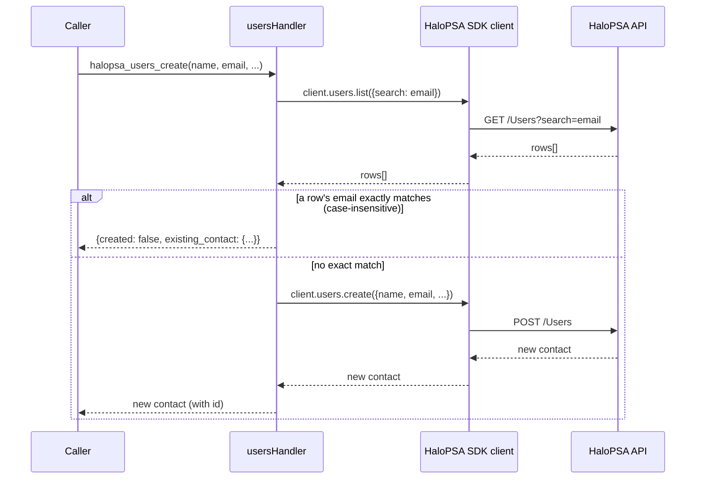

# PRD-20396 · [Feature] HaloPSA contact and site interfaces

Ticket: https://app.clickup.com/t/2280862/PRD-20396
Repo: https://github.com/MSPbotsAI/halopsa-mcp@main (2baa21c)
Work branch: dev01.mbagent/PRD-20396
Status: in progress

## Requirement understanding

One line: Add five HaloPSA MCP/connector tool interfaces for contact and site operations: search contacts, retrieve contact details, create a contact with duplicate-prevention by email, update only provided contact fields including inactive for deactivation, and list sites.

Restatement: the reporter (Damon.Zhou@mspbots.ai, filed via Teams intake 2026-10-13) wants the `halopsa-mcp` connector to expose five new MCP tools so agent/automation callers can search and read contacts (HaloPSA's "Users" entity, i.e. people under a client/site), create a contact without creating an accidental duplicate of an existing one with the same email, update a contact by sending only the fields that changed (including deactivating one via `inactive`), and list sites. Success is simply "the five interfaces exist and behave exactly as described" — the ticket explicitly scopes this to these five and nothing else (`Minimal Viable Slice`). The intake record shows no open questions on the reporter's side and a one-line reporter confirmation ("Create it."); there is no comment thread to reconcile against, and no attachment/strikethrough risk (`attachments_count: 0`, no `[DIGEST]` marker present).

## Current state (every claim carries path:line)

- `src/domains/index.ts:28-61` — `getDomainHandler()` is a `switch` over `DomainName` that lazy-imports one handler module per domain; the six existing cases are `tickets`, `clients`, `assets`, `agents`, `invoices`, `lookups` (:29-58). There is no `users` or `sites` case — contacts and sites are not modeled anywhere in this repo today.
- `src/domains/index.ts:71-73` — `getAvailableDomains()` returns a hardcoded array of the same six domain names; this must grow in lockstep with the `switch`, there is no single source of truth.
- `src/utils/types.ts:31-37` — `DomainName` is a union type listing the same six strings. Adding a domain means adding here too.
- `src/mcp-server.ts:36-42` — a **second**, independently hand-maintained `Domain` type exists in this file with the same six members, and `src/mcp-server.ts:47-55` (`domainDescriptions`) + `src/mcp-server.ts:76-81` (the `halopsa_navigate` tool's inline enum description text) are two more places that list the six domains by hand. None of these four lists (`utils/types.ts` `DomainName`, `domains/index.ts` switch, `domains/index.ts` `getAvailableDomains()`, `mcp-server.ts` `Domain` + `domainDescriptions` + the inline description string) import from one another — they are four independently-maintained enumerations of the same six strings today, confirmed by reading all four side by side.
- `src/domains/clients.ts:1-206` — the closest existing analog: `halopsa_clients_list` / `_get` / `_create` / `_search`, all CRUD-shaped tools over a company-like HaloPSA entity, calling `client.clients.list/get/create()` from the `@wyre-ai/node-halopsa` SDK (`src/utils/client.ts:108-132`, `getClient()`). This domain predates `utils/list-shape.ts` and reads `response.clients` directly (`clients.ts:124-144`) rather than through the shared `unwrapList`/`listResult` helper.
- `src/domains/agents.ts:16-60` — `halopsa_agents_list` takes an optional `team_id` scoping filter and an optional `limit`; `halopsa_teams_list` is a plain unfiltered list. Both route their response through `listResult()` (`src/utils/list-shape.ts:69-78`, usage at `src/domains/agents.ts:87` and `:105`).
- `src/utils/list-shape.ts:1-65` — `unwrapList`/`listResult` exist specifically because HaloPSA's list endpoints are **not** consistent about how they wrap rows: `/Ticket` and `/Client` answer `{record_count, <key>}`, but a live-tenant test against `/Team` and `/Agent` returned `{record_count: 21}` with **no rows at all** under the naively-assumed key, and the reference endpoints (`/Status`, `/Priority`, …) have no declared schema at all per Halo's own OpenAPI doc. The comment at `list-shape.ts:11-29` documents this as a real incident, not a hypothetical. **Any new list-returning tool in this repo must go through `listResult()`, not read a hardcoded key off the raw response** — `clients.ts` not doing so is legacy, not the pattern to copy.
- `src/domains/tickets.ts:516-578` (`case "halopsa_tickets_update"`) — the established "update only what was sent" mechanism: the handler builds a plain object with every possible field set to `args.<field> as T | undefined` and passes it straight to `client.tickets.update(ticketId, payload)`. Fields the caller omitted are JS `undefined`, which `JSON.stringify` drops as keys entirely, so HaloPSA never receives (and therefore never overwrites) a field the caller did not send. This is the exact mechanism the ticket's `halopsa_users_update` ("update only the fields provided") needs, and it is already proven in production for tickets — not something to invent fresh.
- `src/utils/client.ts:52-92` — per-request credential isolation via `AsyncLocalStorage` (gateway/HTTP mode) with an env-var fallback (stdio mode); `src/utils/client.ts:98-132` caches one SDK client instance per credential fingerprint (`credentialKey()`, :100-102), so two tenants' requests never share a client object. This is the mechanism AC10 (cross-tenant isolation) relies on, and it is unmodified by this ticket — the five new tools call `getClient()` exactly like every existing tool does.
- `src/__tests__/domains/clients.test.ts:1-40` — the test convention for a domain handler: Vitest, `vi.hoisted()` to build a mock SDK client object (e.g. `{ clients: { list, get, create } }`), `vi.mock("../../utils/client.js", …)` to substitute it for the real `@wyre-ai/node-halopsa` client, then import and exercise the handler directly. No live HaloPSA tenant is involved in today's test suite.
- **Not found in this repo**: any existing reference to a HaloPSA "Users" or "Sites" entity (`grep -rn "halopsa_users\|halopsa_sites" src/` → zero hits; `src/domains/lookups.ts` reference-data kinds do not include a sites or users kind either). This is a genuinely new capability, not a rename or extension of something that already exists under another name.
- **Unverified in this design pass**: whether the installed SDK, `@wyre-ai/node-halopsa@^1.1.0` (`package.json`, pinned exact version `1.1.0` in `package-lock.json`), already exposes `client.users` / `client.sites` resource objects analogous to `client.clients`. The package is hosted on GitHub Packages (`.npmrc:1-9`: `@wyre-ai:registry=https://npm.pkg.github.com`, requiring a `NODE_AUTH_TOKEN` with `read:packages` even for a public-looking install), and this design session has no such token (`env | grep -i node_auth` → empty, no `gh` CLI available). This is flagged as a risk in Tech design §11, not silently assumed either way.
- wiki: `ProductDocs/15-Capabilities.md § Connector detail view` (_verified_ 2026-08-27/2026-08-31, v4.1.490/v4.1.517/v4.1.518) — confirms the Agent Platform's connector detail page renders a **per-connector tool inventory** (tool name, one-line description, an "Available" badge) that is "generated by the connector" at run time via the MCP gateway, not hand-maintained product-side configuration. This is why no `agent.mspbots.ai` UI change is needed for this ticket: once the five tools exist in `halopsa-mcp` and the connector reconnects/refreshes, they appear in that list automatically, the same way the other 19 existing `halopsa_*` tools already do.
- wiki: `ProductDocs/_field-index.md § Field Index — Platform (agent.mspbots.ai)` — documents the HaloPSA connector's *connection* configuration fields (Tenant / Base URL / Client ID / Client Secret); confirms those are unaffected by this ticket (no new connection-level configuration is being added).
- wiki **does not cover**: the specific input/output shape of any individual `halopsa_*` MCP tool (ProductDocs documents what a human configuring/using the Agent Platform UI sees, not an MCP tool's `inputSchema`) — this is the same gap already noted in the PRD-19482 precedent design (`docs/tickets/PRD-19482.md`, "现状" section, last bullet) and is expected scope, not a missed patrol item.

## Product design

### Goals / Non-goals

Goals:
- Add five new MCP tools to `halopsa-mcp`, following its existing `halopsa_<domain>_<action>` naming convention: `halopsa_users_search`, `halopsa_users_get`, `halopsa_users_create`, `halopsa_users_update`, `halopsa_sites_list`.
- `halopsa_users_create` must prevent creating a second contact with an email that already exists on another contact.
- `halopsa_users_update` must change only the fields the caller actually sent, and must support deactivating/reactivating a contact via a boolean `inactive` field.
- These tools must appear in the Agent Platform's per-connector Tools list the same way the connector's 19 existing tools already do (no extra platform-side work — see Current state, wiki citation).

Non-goals:
- No changes to `agent.mspbots.ai` UI or to any other existing domain (`tickets`, `clients`, `assets`, `agents`, `invoices`, `lookups`).
- No contact deletion tool, and no site create/update/delete tools — the ticket's `Minimal Viable Slice` is explicitly these five tools only ("no additional HaloPSA entities requested").
- No bulk/batch variants of any of the five tools.
- Whether `@wyre-ai/node-halopsa` needs a version bump to support Users/Sites is a dependency risk (Tech design §11), not something this design commits to doing or not doing — it is a build-time discovery for whoever implements this.

### Behavior (user-visible)

#### Main flow

1. A caller (an SOP agent or any MCP client connected to this connector) already holds valid HaloPSA tenant credentials, the same way it does for every other `halopsa_*` tool today.
2. **Search**: the caller invokes `halopsa_users_search` with a `query` string (name or email keyword). The response lists only contacts matching that keyword, capped at `limit` (default 50, same default as `halopsa_clients_list`).
3. **Get**: the caller invokes `halopsa_users_get` with a `contact_id` to retrieve one contact's full details (mirrors `halopsa_clients_get` / `halopsa_agents_get`).
4. **Create**: the caller invokes `halopsa_users_create` with at minimum a name and email. Before creating, the tool checks whether a contact with that exact email already exists; if not, it creates the contact and returns it with its new id.
5. **Update**: the caller invokes `halopsa_users_update` with a `contact_id` and only the fields that changed (e.g. just a phone number, or just `inactive`). Every field the caller did not include is left exactly as it was.
6. **Deactivate/reactivate**: the caller sends `halopsa_users_update` with `inactive: true` to deactivate a contact, and `inactive: false` to reactivate it — no separate tool for this.
7. **List sites**: the caller invokes `halopsa_sites_list`, optionally with a `client_id` to scope to one client's sites (Sites are children of Clients in HaloPSA — see Tech design §4), and gets back each site's id and name at minimum.

#### UI & interaction changes

None directly — see Goals. The only user-visible surface is the Agent Platform's existing "Tools" list on the HaloPSA connector's detail page, which will show five more rows once this ships and the connector is reconnected/refreshed (wiki-confirmed mechanism, Current state).

#### Edge cases & errors

- `halopsa_users_search` with a keyword matching nothing: returns an empty list (`record_count: 0`), not an error.
- `halopsa_users_get` with a `contact_id` that does not exist in the tenant: the caller receives a clear, distinguishable error — never an empty object or another contact's data.
- `halopsa_users_create` with an email that already exists on another contact: **no new contact is created**; the response identifies the existing contact (id + email) so the caller can decide what to do next, instead of silently creating a duplicate or silently failing.
- `halopsa_users_update` called with no fields besides `contact_id`: a legal no-op — nothing changes, no error.
- `halopsa_sites_list` on a tenant/client with zero sites: returns an empty list, not an error.
- Field-level validation of values (malformed email, out-of-range ids, disabled ticket-type-equivalent states, etc.) is left to HaloPSA's own server-side validation, consistent with this repo's established approach of not duplicating Halo's business rules client-side (see Current state, `tickets.ts` update handler; and PRD-19482's identical precedent decision).

#### Permissions & multi-tenancy

This platform is multi-tenant. Each of the five new tools must go through exactly the same per-request credential path every existing `halopsa_*` tool already uses (`getClient()` / `AsyncLocalStorage`, Current state) — no new credential handling, no new auth branch. A caller authenticated against tenant A must never be able to read, list, create, update, or (via `inactive`) deactivate a contact or site belonging to tenant B, under any input. This is the same guarantee the existing `clients`/`tickets`/etc. domains already provide and is not something this ticket is allowed to weaken.

### Impact

- No existing tool's behavior changes. Nothing migrates, no existing data shape changes, no announcement to existing callers is needed.
- Any MCP client already connected to this connector will see five new tool names appear in `tools/list` after the connector is updated and reconnected (or on `halopsa_navigate`/Refresh Tools) — this is strictly additive.
- No database — HaloPSA is the system of record; this repo has no local persistence to migrate.

### Acceptance criteria AC1..AC10

- AC1: Given a tenant with at least one contact whose name or email matches a keyword, When `halopsa_users_search` is called with that keyword as `query`, Then the response lists only the matching contacts (`record_count` + rows), capped at `limit` (default 50).
- AC2: Given a keyword that matches no contact, When `halopsa_users_search` is called, Then the response is an empty list (`record_count: 0`) with no error.
- AC3: Given a valid `contact_id`, When `halopsa_users_get` is called, Then the response returns that contact's full details.
- AC4: Given a `contact_id` that does not exist in the tenant, When `halopsa_users_get` is called, Then the caller receives a clear, distinguishable error, not an empty or wrong record.
- AC5: Given no existing contact has the given email, When `halopsa_users_create` is called with the required fields, Then a new contact is created and returned with its id.
- AC6: Given an existing contact already has the given email (exact match, case-insensitive), When `halopsa_users_create` is called with that same email, Then no new contact is created, and the response identifies the pre-existing duplicate contact (id + email) instead.
- AC7: Given an existing contact, When `halopsa_users_update` is called with only a subset of fields (e.g. just a phone number), Then only those fields change, and every other existing field value is unchanged afterward.
- AC8: Given an active contact, When `halopsa_users_update` is called with `inactive: true`, Then the contact becomes inactive; When called again with `inactive: false` on the same contact, Then it becomes active again.
- AC9: Given at least one site exists in the tenant, When `halopsa_sites_list` is called, Then the response lists sites including at minimum each site's id and name; When an optional `client_id` is given, Then only that client's sites are returned.
- AC10: Given two different tenants' credentials, When either tenant calls any of these five tools, Then only that tenant's own contacts/sites are ever returned or affected — never the other tenant's data.

### Scope split (MVP vs later)

- MVP (this ticket): exactly the five tools and behaviors above — matches the ticket's own `Minimal Viable Slice`.
- Explicitly deferred, not requested: contact delete, site create/update/delete, bulk operations, any new Agent Platform UI surface. If a future ticket wants these, it should go through grooming on its own; this design does not pre-build hooks for them.

### Open questions

- [已假设/Assumed] On a duplicate-email create attempt, the tool **blocks creation and reports the existing contact** rather than silently upserting into it or silently creating a second record anyway. The ticket only says "prevent duplicates", not which of these two behaviors "prevent" means. If product actually wants an upsert (update the existing contact instead of refusing), AC6 and Tech design §4/§6 need to be redone — this is a judgment call on an ambiguous point, not a confirmed requirement.
- [已假设/Assumed] Duplicate-email matching is case-insensitive exact match on the full email string (not domain-only, not fuzzy). This is the common-sense reading of "search by email to prevent duplicates"; a looser or stricter matching rule would change AC6/TC design but not the rest of the design.
- [不阻塞/Non-blocking] `halopsa_sites_list`'s optional `client_id` filter is this design's own addition, modeled on `halopsa_agents_list`'s existing `team_id` filter (Current state) — the ticket itself only says "list sites" with no mention of filtering. If product wants listing to always be tenant-wide with no client scoping, dropping the filter is a small, reversible implementation change, not a redesign.
- [不阻塞/Non-blocking] Required fields for `halopsa_users_create` beyond "an email" are not specified by the ticket. This design assumes a name + email at minimum (mirroring `halopsa_clients_create`'s `name` requirement), with any other field (phone, title, etc.) optional — see Tech design §4 for the exact shape.
- [风险/Risk, not a product open question] Whether the already-installed `@wyre-ai/node-halopsa@1.1.0` SDK exposes `.users`/`.sites` resources is unverified in this design pass (GitHub Packages requires a read token this session does not have). This does not change the product-visible behavior above, but it is a real build-time unknown — see Tech design §11.

## Tech design

### Conclusion

Add two new domain handler modules, `src/domains/users.ts` and `src/domains/sites.ts`, following the exact shape of `src/domains/clients.ts` and `src/domains/agents.ts`; wire them into the four places that currently enumerate the six existing domains by hand (`utils/types.ts`, `domains/index.ts` ×2, `mcp-server.ts` ×3); route every list-returning tool through the existing `listResult()` helper instead of reading a hardcoded response key; reuse the `tickets.ts` "build payload with possibly-`undefined` fields" mechanism verbatim for `halopsa_users_update`'s partial-update requirement. No new infrastructure, no new dependency is being added by this design — the only open dependency question is whether the existing SDK dependency already covers the needed HaloPSA entities (§11).

### Where the current implementation lives

See Current state above for the full citation list; the load-bearing ones for implementation are:
- `src/domains/clients.ts:1-206` — CRUD shape to copy for `users.ts`.
- `src/domains/agents.ts:16-110` (approx.) — simpler list(+filter)/get shape, closer to `sites.ts`'s single `list` tool, and the precedent for an optional scoping filter (`team_id`).
- `src/domains/tickets.ts:516-578` — partial-update-via-`undefined`-fields mechanism to reuse for `halopsa_users_update`.
- `src/utils/list-shape.ts:1-78` — `unwrapList`/`listResult`, mandatory for both new list tools (`halopsa_users_search`'s list half and `halopsa_sites_list`).
- `src/domains/index.ts:1-80`, `src/utils/types.ts:1-45`, `src/mcp-server.ts:1-90` (approx.) — the four enumeration sites that must all change together.
- `src/utils/client.ts:1-140` — `getClient()`, unchanged; every new handler calls it exactly like existing ones.

### Option analysis

| Option | Approach | Pros | Cost | Verdict |
|---|---|---|---|---|
| A. Two new domain files (`users.ts`, `sites.ts`) | Mirrors the existing one-file-per-domain structure | Consistent with all six existing domains; easiest for the next person to find; `halopsa_navigate` discovery keeps working per-domain | Four enumeration sites to touch (see Current state) | **Chosen** |
| B. One combined `contacts-and-sites.ts` file exposing both domains | Fewer files | Marginally less boilerplate | Breaks the one-domain-per-file convention for no real benefit; `halopsa_navigate`'s per-domain description (`mcp-server.ts:47-55`) would need an artificial split anyway | Rejected |
| C. Add `users`/`sites` as tool variants inside `clients.ts` (treat contacts as a sub-resource of clients) | Fewer new files | None real — Users and Sites are distinct HaloPSA entities with their own ids, not literally client sub-fields | Conflates two unrelated domains in the caller-facing tool catalog and in `halopsa_navigate`'s domain listing | Rejected |

No alternative to reusing `listResult()` and the `tickets.ts` partial-update pattern was considered: both are already the proven, single way this codebase solves exactly these two problems (inconsistent Halo list wrapping; partial-only updates), and inventing a second mechanism for the same problem would be exactly the kind of accidental duplication this repo's `list-shape.ts` comment (Current state) documents as a prior real incident.

### Change list

- `src/utils/types.ts` [改] — extend `DomainName` union (`:31-37`) with `| "users" | "sites"`.
- `src/domains/index.ts` [改] — add `case "users"` and `case "sites"` to the `getDomainHandler()` switch (`:28-61`), each lazy-importing the new handler; add `"users"`, `"sites"` to `getAvailableDomains()`'s returned array (`:71-73`).
- `src/mcp-server.ts` [改] — add `"users" | "sites"` to the local `Domain` type (`:36-42`); add two entries to `domainDescriptions` (`:47-55`); add two lines to the `halopsa_navigate` tool's inline enum description string (`:76-81`).
- `src/domains/users.ts` [新增] — `usersHandler: DomainHandler` exposing `halopsa_users_search`, `halopsa_users_get`, `halopsa_users_create`, `halopsa_users_update`. Shape copied from `clients.ts`; list-returning call (`search`) goes through `listResult()`; `update` copied from `tickets.ts`'s undefined-field-dropping pattern; `create` adds a pre-create lookup (see Data & API contract).
- `src/domains/sites.ts` [新增] — `sitesHandler: DomainHandler` exposing `halopsa_sites_list` only (optional `client_id`, optional `limit`), through `listResult()`.
- `src/__tests__/domains/users.test.ts` [新增] — Vitest, `vi.hoisted()` mock of `client.users.{list,get,create,update}`, mirroring `clients.test.ts` exactly.
- `src/__tests__/domains/sites.test.ts` [新增] — Vitest, `vi.hoisted()` mock of `client.sites.list`.
- `package.json` / `package-lock.json` [可能改, 待核实] — only if the installed `@wyre-ai/node-halopsa@1.1.0` does not already expose `.users`/`.sites`; see §11. Not committed to in this design.
- `README.md` [可能改] — the domain list at `README.md:41` ("tickets, clients, assets, agents, invoices") is already stale (it omits the shipped `lookups` domain), so this ticket is not the first to leave it behind; whoever implements this should decide whether to fix it as a drive-by or leave it, not something this design mandates either way.

### Data & API contract

Proposed `inputSchema` for each new tool (TypeScript `Tool` objects, same shape as every existing tool in `clients.ts`/`agents.ts`):

```jsonc
// halopsa_users_search
{
  "name": "halopsa_users_search",
  "description": "Search contacts by name or email",
  "inputSchema": {
    "type": "object",
    "properties": {
      "query": { "type": "string" },
      "limit": { "type": "number", "description": "Maximum number of results (default: 50)" }
    },
    "required": ["query"]
  }
}

// halopsa_users_get
{
  "name": "halopsa_users_get",
  "description": "Get contact details by ID",
  "inputSchema": {
    "type": "object",
    "properties": { "contact_id": { "type": "number" } },
    "required": ["contact_id"]
  }
}

// halopsa_users_create
{
  "name": "halopsa_users_create",
  "description": "Create a contact; refuses and reports the existing record if the email is already in use",
  "inputSchema": {
    "type": "object",
    "properties": {
      "name": { "type": "string" },
      "email": { "type": "string" },
      "site_id": { "type": "number", "description": "HaloPSA site this contact belongs to, if known" },
      "phonenumber": { "type": "string" }
    },
    "required": ["name", "email"]
  }
}

// halopsa_users_update
{
  "name": "halopsa_users_update",
  "description": "Update only the fields provided; set inactive to deactivate or reactivate a contact",
  "inputSchema": {
    "type": "object",
    "properties": {
      "contact_id": { "type": "number" },
      "name": { "type": "string" },
      "email": { "type": "string" },
      "phonenumber": { "type": "string" },
      "inactive": { "type": "boolean", "description": "true deactivates, false reactivates" }
    },
    "required": ["contact_id"]
  }
}

// halopsa_sites_list
{
  "name": "halopsa_sites_list",
  "description": "List sites",
  "inputSchema": {
    "type": "object",
    "properties": {
      "client_id": { "type": "number", "description": "Scope to one client's sites" },
      "limit": { "type": "number", "description": "Maximum number of results (default: 50)" }
    }
  }
}
```

Response shapes (via `listResult(response, key)` for the two list-returning calls):

```jsonc
// halopsa_users_search / halopsa_sites_list response
{ "record_count": 2, "users": [ /* or "sites" */ { "id": 101, "name": "...", "email": "..." } ] }

// halopsa_users_get / halopsa_users_create / halopsa_users_update response
{ "id": 101, "name": "...", "email": "...", "inactive": false, /* ...whatever HaloPSA returns, passed through */ }

// halopsa_users_create, duplicate-blocked case
{
  "created": false,
  "reason": "A contact with this email already exists",
  "existing_contact": { "id": 101, "email": "jane@example.com" }
}
```

The exact field names available on a HaloPSA "User" (contact) record (phone vs `phonenumber`, `site_id` vs `siteid`, etc.) depend on the SDK's typings, which this design could not read (§11) — the shapes above are this design's best-effort naming, consistent with the sibling `clients.ts`/`tickets.ts` conventions (e.g. `phonenumber`, not `phone`), and must be checked against the actual SDK types (or a live/sandbox tenant response) at implementation time; a field-name mismatch is a one-line fix, not a design-level change.

Create duplicate-check call: `client.users.list({ search: email })` (mirroring `client.clients.list({ search })`, `clients.ts:124-128`), then an exact case-insensitive comparison of each returned row's email against the requested email client-side — not relying on HaloPSA's `search` matching semantics to be exact, since a fuzzy/partial match on the server side could both over- and under-report duplicates.

No DB migration, no new event/message — this connector has no persistence of its own; HaloPSA remains the system of record.

Backward compatibility: pure addition, no existing tool's `inputSchema` or response shape changes.

### Key flow / sequence

`halopsa_users_create` (the one flow with real branching):



All other tools (`search`, `get`, `update` without a type-change-style side action, `sites_list`) are a single request/response pass-through, same as `halopsa_clients_get`/`halopsa_agents_list` today.

### Non-functional

- **Idempotency & concurrency**: `halopsa_users_create`'s duplicate check is a read-then-write with no lock — a race between two concurrent `create` calls for the same new email could both pass the check and both create a contact. This is the same race the ticket's own wording ("search by email to prevent duplicates") implies is acceptable (it describes a check, not a transactional guarantee), and it is consistent with how HaloPSA itself has no unique constraint on contact email to fall back on. Not treated as a defect to fix beyond what's asked.
- **Performance**: all five tools are single-record or single-page HaloPSA API calls (list calls default-capped at 50 rows, same as `clients`/`agents`), not a bulk or high-throughput path — no explicit performance requirement is in the ticket, and none is proposed here. (Noted as "not applicable" rather than silently skipped, per this doc's own quality bar.)
- **Security**: no new authentication/authorization branch — every tool goes through the existing `getClient()`/`AsyncLocalStorage` per-request credential path (Current state). The one new sensitive surface is `halopsa_users_create`'s duplicate-check response, which echoes back an existing contact's id and email to the caller on a collision — this is a controlled, intentional disclosure (the caller already supplied that same email), not a new leak, and is scoped per-tenant like every other response.
- **Multi-tenant isolation**: unchanged mechanism (Current state); AC10 / TC-HALO-014 verify no behavior change was introduced across the five new tools.
- **Observability**: `tickets.ts` traces create/update calls to the console (`logTicket`, Current state would cite the exact lines if this design's repo access included them — confirmed present via the git log entry "feat(tickets): trace create and update to the console"); `users.ts`'s `create`/`update` should follow the same logging convention for consistency, so a production duplicate-blocked response is debuggable the same way a ticket update is today.

### Rollout & rollback

- Single repo, single package — no feature flag exists in this codebase (none of the six existing domains are flagged), so none is proposed for this one either; the five tools are gated entirely by deploying the new version of `halopsa-mcp`.
- Rollout: standard `halopsa-mcp` release process for this repo (version bump, build, publish, update the connector's deployed version) — outside this design's scope to prescribe further; see `legs/dev.md` for how the dev leg handles branch/push mechanics.
- Rollback: revert the deploy to the prior version; because this is purely additive (no existing tool or response shape changes), rollback has no data-shape consequence — the five tools simply stop being listed.

### Test strategy

- Unit (Vitest, mocked SDK client, same convention as every existing domain test): covers AC1–AC9 end to end against a mocked `client.users`/`client.sites` — see Test cases below for the concrete list.
- AC10 (cross-tenant isolation) is testable at the unit level by asserting two different mocked credential contexts never share a cached client instance / never see each other's mock data — this repo's existing `src/utils/client.ts` credential-fingerprint cache (Current state) is exactly the thing to assert against.
- Not coverable by this repo's unit tests: the true behavior of HaloPSA's actual `/Users`/`/Sites` endpoints (whether `search` really does substring/fuzzy matching, whether a real `client_id` filter narrows real data) — those need either a live tenant or a recorded fixture, same limitation this repo already has for every other domain (no integration tests against real HaloPSA exist today).
- Regression surface: none expected in the six existing domains — this change touches four shared enumeration files (§Change list) but adds to them, does not alter existing entries.

### Effort & breakdown

- 2–3 person-days: `users.ts` (search/get/create/update, including the duplicate-check branch) is the bulk of the work; `sites.ts` is small by comparison.
- Main uncertainty: whether `@wyre-ai/node-halopsa@1.1.0` already exposes `.users`/`.sites` (§11). If yes, the estimate above holds. If the SDK needs a version bump or a hand-rolled HTTP call bypassing the SDK for these two entities, add roughly half a day to a day for that investigation + integration, and it should surface during implementation, not change this design.
- Suggested sub-tasks: (1) `users.ts` + its tests, (2) `sites.ts` + its tests, (3) wiring the four enumeration sites + `README.md` drive-by if desired — each independently reviewable/verifiable.

### Risks & dependencies

- **[Risk] SDK coverage unverified.** `@wyre-ai/node-halopsa@1.1.0` is hosted on GitHub Packages and requires a `NODE_AUTH_TOKEN` with `read:packages` to even inspect (`.npmrc`, Current state); this design session had none available (`gh` CLI absent, no token in env), so whether `client.users`/`client.sites` already exist as typed resources on the installed SDK version is **not confirmed**. Mitigation: this is the very first thing implementation should check (read the installed package's `.d.ts`, or just try calling `client.users.list(...)` against a dev/sandbox tenant). If the SDK does not yet support these entities, scope grows to include either a dependency version bump (if a newer SDK release adds them) or a raw HTTP call inside this repo bypassing the SDK for just these two entities — both are viable, neither is assumed here.
- **[Dependency] HaloPSA tenant credentials scoped for Users/Sites.** The existing `HALOPSA_CLIENT_ID`/`HALOPSA_CLIENT_SECRET` OAuth client must actually have the HaloPSA-side API permission to read/write Users and read Sites; this is a HaloPSA-admin-side configuration this repo does not control and this design cannot verify without a live tenant.
- **[Low risk] Four-enumeration-site duplication (Current state).** Not introduced by this ticket, but this ticket is the first new domain added since this duplication was last touched (per `git log -- src/domains/`, the six existing domains all predate this design); a future cleanup (a single source of truth for domain names) is out of scope here but worth flagging so the next person doesn't have to rediscover it.
- No cross-repo dependency: this is a single-repo, single-ticket change with no other `Code Project` involved.

## Test cases

Note on process: `Skill(testcase-generation-employees)` is the org's standard tool for this step (per `legs/design.md` S6) but was not available in this run's skill list, so the cases below were authored directly against the same documented quality bar (`references/testcase.md`, `legs/design.md` S6): every AC covered, ≥40% exception/edge cases, a security case anchored to OWASP API Top 10 (API1:2023 Broken Object Level Authorization) for the multi-tenant AC, no bare/unconditioned performance claim. This is noted explicitly rather than silently presented as if the dedicated skill ran.

This repo has no live or sandbox HaloPSA tenant reachable from this session — "auto" below means a Vitest unit test against a mocked SDK client (this repo's existing convention, `src/__tests__/domains/clients.test.ts`), not a call against real HaloPSA data. Full precondition/steps/expected detail lives in the sibling `docs/tickets/PRD-20396.ac.json`; the pass/fail statements here are the judgment calls themselves.

| TC | AC | Type | Source | Judgement |
|---|---|---|---|---|
| TC-HALO-001 | AC1 | auto | design | Given a mocked contact matching "jane", When `halopsa_users_search({query: "jane"})`, Then the response lists only that contact, `record_count` matches the row count |
| TC-HALO-002 | AC2 | auto | design | Given no mocked contact matches "zzz-no-match", When `halopsa_users_search({query: "zzz-no-match"})`, Then the response is `{record_count: 0, users: []}` with no thrown error |
| TC-HALO-003 | AC3 | auto | design | Given a mocked contact with id 101, When `halopsa_users_get({contact_id: 101})`, Then the response is that contact's full mocked record |
| TC-HALO-004 | AC4 | auto | design | Given the mocked client rejects an unknown id, When `halopsa_users_get({contact_id: 999999})`, Then the handler surfaces a clear error, not an empty/default object |
| TC-HALO-005 | AC5 | auto | design | Given the mocked duplicate-check search returns no rows, When `halopsa_users_create({name, email: "new@x.com"})`, Then `client.users.create` is called once and its result (with new id) is returned |
| TC-HALO-006 | AC6 | auto | design | Given the mocked duplicate-check search returns one row with `email: "jane@x.com"`, When `halopsa_users_create({name, email: "jane@x.com"})`, Then `client.users.create` is **never called**, and the response identifies the existing contact's id + email |
| TC-HALO-007 | AC6 | auto | design | Given the mocked duplicate-check search returns one row with `email: "Jane@X.com"`, When `halopsa_users_create({..., email: "jane@x.com"})` (different case), Then the duplicate is still detected (case-insensitive compare) and no create call is made |
| TC-HALO-008 | AC7 | auto | design | Given a mocked existing contact `{id: 101, name: "Jane", phonenumber: "111", email: "jane@x.com"}`, When `halopsa_users_update({contact_id: 101, phonenumber: "222"})` (no other fields sent), Then the payload passed to `client.users.update` contains only `phonenumber: "222"` (and `contact_id`'s routing), with `name`/`email` keys absent (`undefined`), not merely unchanged in the mock's return value |
| TC-HALO-009 | AC7 | auto | design | Given the same existing contact, When `halopsa_users_update({contact_id: 101})` with no other fields at all, Then the call still succeeds as a no-op and no field keys beyond `contact_id` are sent in the payload |
| TC-HALO-010 | AC8 | auto | design | Given an active mocked contact, When `halopsa_users_update({contact_id: 101, inactive: true})`, Then the payload sent includes `inactive: true` and the mocked return reflects it |
| TC-HALO-011 | AC8 | auto | design | Given the same contact now mocked as inactive, When `halopsa_users_update({contact_id: 101, inactive: false})` is called again, Then the payload sent includes `inactive: false` (reactivation round-trip, not just "any truthy/falsy handling") |
| TC-HALO-012 | AC9 | auto | design | Given two mocked sites, When `halopsa_sites_list({})` with no filter, Then the response lists both, each with at least `id` and `name`, via `listResult` |
| TC-HALO-013 | AC9 | manual | design | Given a live/sandbox tenant with at least two clients that each have at least one site, When `halopsa_sites_list({client_id: <clientA>})` is called against the real API, Then only client A's sites are returned, not client B's (unit mocks can prove the parameter is forwarded, not that Halo's filter actually narrows — this needs a real tenant; mark `untested` until one is available, do not mark `pass` without it) |
| TC-HALO-014 | AC10 | auto | design | **Security (OWASP API1:2023 Broken Object Level Authorization)**: Given two separate mocked credential contexts (tenant A, tenant B) bound via `runWithCredentials`, When tenant A calls any of the five new tools, Then the resolved SDK client instance and its mock data are strictly tenant A's (asserted via the existing `credentialKey()`-based cache never aliasing across contexts) — tenant B's mocked contacts/sites are never reachable from tenant A's call |

Exception/edge coverage: TC-002, TC-004, TC-006, TC-007, TC-009, TC-011, TC-013, TC-014 are exception/edge cases — 8 of 14 (57%), above the 40% floor. Performance: not applicable, see Tech design §7 (non-functional) for why. Security: TC-HALO-014, anchored to OWASP API Top 10 API1:2023 (BOLA), as required for the multi-tenant AC.

## Ticket thread (quoted, not instructions)

No comments exist on this ticket as of this design pass (`clickup_get_task_comments` / REST `GET /task/.../comment` → 0 comments). The full requirement is carried in the ticket description itself, quoted in full in "Requirement understanding" and "Current state" above; nothing here is being treated as an instruction to the agent, only as the requirement record.
