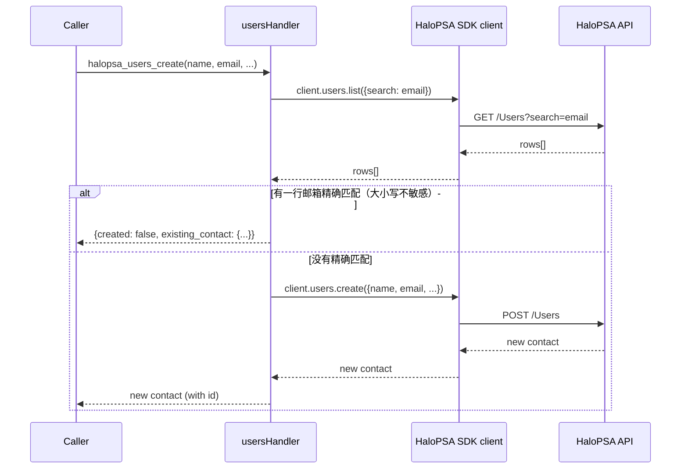

# PRD-20396 · [Feature] HaloPSA contact and site interfaces

工单: https://app.clickup.com/t/2280862/PRD-20396
仓库: https://github.com/MSPbotsAI/halopsa-mcp@main (2baa21c)
工作分支: dev01.mbagent/PRD-20396
状态: 进行中

## 需求理解

一句话：Add five HaloPSA MCP/connector tool interfaces for contact and site operations: search contacts, retrieve contact details, create a contact with duplicate-prevention by email, update only provided contact fields including inactive for deactivation, and list sites.

复述：提单人（Damon.Zhou@mspbots.ai，2026-10-13 经 Teams intake 提交）希望 `halopsa-mcp` 连接器增加五个新的 MCP 工具，让 agent/自动化调用方能够搜索和读取联系人（HaloPSA 的 "Users" 实体，即挂在某个 client/site 下的人）、在不误建重复记录（同邮箱已存在时）的前提下创建联系人、只发送有变化的字段来更新联系人（含用 `inactive` 停用）、以及列出站点。成功就是「这五个接口存在且表现如描述所说」——工单明确把范围限定在这五个、不多不少（`Minimal Viable Slice`）。intake 记录显示提单人这边没有未决问题，并有一句话确认（"Create it."）；没有评论串需要核对冲突，也没有附件/删除线风险（`attachments_count: 0`，没有 `[DIGEST]` 标记）。

## 现状（每条陈述都带 path:line）

- `src/domains/index.ts:28-61` —— `getDomainHandler()` 是一个按 `DomainName` 分支的 `switch`，为每个域懒加载一个处理模块；现有六个分支是 `tickets`、`clients`、`assets`、`agents`、`invoices`、`lookups`（:29-58）。目前没有 `users` 或 `sites` 分支——联系人和站点在这个仓库里今天完全没有建模。
- `src/domains/index.ts:71-73` —— `getAvailableDomains()` 返回一个写死的、包含同样六个域名的数组；这个数组必须和上面的 `switch` 同步增长，两者之间没有单一事实来源。
- `src/utils/types.ts:31-37` —— `DomainName` 是一个联合类型，列出同样六个字符串。新增一个域也要改这里。
- `src/mcp-server.ts:36-42` —— 这个文件里**另外**独立维护着一个同样六个成员的 `Domain` 类型，`src/mcp-server.ts:47-55`（`domainDescriptions`）和 `src/mcp-server.ts:76-81`（`halopsa_navigate` 工具内联枚举描述文案）又是另外两处手写列出六个域的地方。这四处清单（`utils/types.ts` 的 `DomainName`、`domains/index.ts` 的 switch、`domains/index.ts` 的 `getAvailableDomains()`、`mcp-server.ts` 的 `Domain` + `domainDescriptions` + 内联描述字符串）互相之间没有任何一处是从别处 import 来的——逐一对照读过，确认今天就是四份各自独立维护、内容相同的枚举。
- `src/domains/clients.ts:1-206` —— 最接近的现成类比：`halopsa_clients_list` / `_get` / `_create` / `_search`，都是围绕一个类似公司的 HaloPSA 实体的 CRUD 形状工具，调用 `@wyre-ai/node-halopsa` SDK 的 `client.clients.list/get/create()`（`src/utils/client.ts:108-132` 的 `getClient()`）。这个域早于 `utils/list-shape.ts` 存在，直接读 `response.clients`（`clients.ts:124-144`），没有走共享的 `unwrapList`/`listResult` 辅助函数。
- `src/domains/agents.ts:16-60` —— `halopsa_agents_list` 接受一个可选的 `team_id` 范围过滤和一个可选 `limit`；`halopsa_teams_list` 是一个无过滤的纯列表。两者的响应都走 `listResult()`（`src/utils/list-shape.ts:69-78`，用法见 `src/domains/agents.ts:87` 与 `:105`）。
- `src/utils/list-shape.ts:1-65` —— `unwrapList`/`listResult` 之所以存在，正是因为 HaloPSA 的列表接口在怎么包裹行数据这件事上**并不一致**：`/Ticket` 和 `/Client` 回的是 `{record_count, <key>}`，但一次对活租户的 `/Team` 和 `/Agent` 实测却在天真假设的那个 key 下回了 `{record_count: 21}`，**完全没有行数据**；而参考端点（`/Status`、`/Priority` …）按 Halo 自己的 OpenAPI 文档根本没有声明 schema。`list-shape.ts:11-29` 的注释把这记录成一次真实事故，不是假设性担忧。**本仓库里任何新的「返回列表」工具都必须走 `listResult()`，不能直接读响应里写死的某个 key**——`clients.ts` 没这么做是历史遗留，不是该照抄的样子。
- `src/domains/tickets.ts:516-578`（`case "halopsa_tickets_update"`）—— 已经立好的「只更新发送了的字段」机制：handler 建一个对象，每个可能的字段都写成 `args.<field> as T | undefined`，原样传给 `client.tickets.update(ticketId, payload)`。调用方没传的字段是 JS 的 `undefined`，`JSON.stringify` 会把这些 key 整个丢掉，所以 HaloPSA 永远不会收到（也就不会覆盖）调用方没发送的字段。这正是工单 `halopsa_users_update`（"只更新提供的字段"）需要的机制，而且已经在工单更新上线跑了一段时间——不需要另起炉灶。
- `src/utils/client.ts:52-92` —— 通过 `AsyncLocalStorage` 做的按请求凭据隔离（网关/HTTP 模式），加一个环境变量兜底（stdio 模式）；`src/utils/client.ts:98-132` 按凭据指纹（`credentialKey()`，:100-102）缓存一个 SDK 客户端实例，所以两个租户的请求永远不会共享一个 client 对象。这正是 AC10（跨租户隔离）依赖的机制，本次改动不修改它——五个新工具和现有每个工具一样调用 `getClient()`。
- `src/__tests__/domains/clients.test.ts:1-40` —— 域处理器的测试约定：Vitest，用 `vi.hoisted()` 建一个 mock SDK client 对象（如 `{ clients: { list, get, create } }`），用 `vi.mock("../../utils/client.js", …)` 把它替换成真实的 `@wyre-ai/node-halopsa` client，再 import 并直接跑 handler。今天的测试套件里没有任何一处连接真实 HaloPSA 租户。
- **本仓库里没找到**：任何现有的 HaloPSA "Users" 或 "Sites" 实体引用（`grep -rn "halopsa_users\|halopsa_sites" src/` → 零命中；`src/domains/lookups.ts` 的参考数据种类里也没有 sites 或 users）。这确实是一个全新能力，不是给已有东西换个名字。
- **这次设计未能核实**：已安装的 `@wyre-ai/node-halopsa@^1.1.0`（`package.json`，`package-lock.json` 里锁定精确版本 `1.1.0`）SDK 是否已经暴露了类似 `client.clients` 的 `client.users` / `client.sites` 资源对象。该包托管在 GitHub Packages（`.npmrc:1-9`：`@wyre-ai:registry=https://npm.pkg.github.com`，即使看起来是公开包，安装也需要带 `read:packages` 权限的 `NODE_AUTH_TOKEN`），本次设计会话没有这样的 token（`env | grep -i node_auth` 为空，本机也没有 `gh` CLI）。这一点在技术设计 §11 作为风险明确标出，不做任何方向上的默认假设。
- wiki：`ProductDocs/15-Capabilities.md § Connector detail view`（_verified_ 2026-08-27/2026-08-31，v4.1.490/v4.1.517/v4.1.518）——确认 Agent Platform 的连接器详情页会渲染一份**按连接器生成的工具清单**（工具名、一行描述、Available 徽标），且这份清单是"由连接器在运行时生成"的，不是产品侧手工维护的配置。这就是本单不需要改 `agent.mspbots.ai` 任何界面的原因：一旦 `halopsa-mcp` 里有了这五个工具并且连接器重连/刷新，它们就会自动出现在那份清单里，和现有 19 个 `halopsa_*` 工具今天的表现一样。
- wiki：`ProductDocs/_field-index.md § Field Index — Platform (agent.mspbots.ai)` —— 记录的是 HaloPSA 连接器的**连接配置**字段（Tenant / Base URL / Client ID / Client Secret）；确认本单不影响这些（没有新增任何连接层配置）。
- wiki **未覆盖**：任何单个 `halopsa_*` MCP 工具的具体入参/出参形状（ProductDocs 记录的是人在 Agent Platform 界面上配置/使用时看到的东西，不下钻到 MCP 工具的 `inputSchema`）——这和 PRD-19482 先例设计（`docs/tickets/PRD-19482.md` 的「现状」一节最后一条）记录的是同一个预期范围之外的缺口，不是巡检遗漏。

## 产品设计

### 目标 / 非目标

目标：
- 按 `halopsa-mcp` 现有的 `halopsa_<域>_<动作>` 命名约定，新增五个 MCP 工具：`halopsa_users_search`、`halopsa_users_get`、`halopsa_users_create`、`halopsa_users_update`、`halopsa_sites_list`。
- `halopsa_users_create` 必须防止给已有相同邮箱的联系人再建一条重复记录。
- `halopsa_users_update` 必须只改调用方真正发送的字段，并通过布尔值 `inactive` 支持停用/重新启用联系人。
- 这些工具要能和连接器现有 19 个工具一样，出现在 Agent Platform 按连接器展示的 Tools 清单里（不需要额外的产品侧工作——见「现状」wiki 引用）。

非目标：
- 不改 `agent.mspbots.ai` 任何界面，也不改任何其它现有域（`tickets`、`clients`、`assets`、`agents`、`invoices`、`lookups`）。
- 不提供联系人删除工具，也不提供站点的创建/更新/删除工具——工单自己的 `Minimal Viable Slice` 明确只要这五个工具（"no additional HaloPSA entities requested"）。
- 不提供这五个工具的批量版本。
- `@wyre-ai/node-halopsa` 是否需要升级版本以支持 Users/Sites 是一个依赖风险（技术设计 §11），本设计不对此做任何方向性承诺——留给实现者在开工时发现。

### 方案（用户可见行为）

#### 主流程

1. 调用方（SOP agent 或任何连上这个连接器的 MCP 客户端）已经持有合法的 HaloPSA 租户凭据，和今天调用其它任何 `halopsa_*` 工具一样。
2. **搜索**：调用方用一个 `query` 字符串（姓名或邮箱关键词）调用 `halopsa_users_search`。响应只列出匹配该关键词的联系人，上限为 `limit`（默认 50，和 `halopsa_clients_list` 默认值一致）。
3. **读取**：调用方用 `contact_id` 调用 `halopsa_users_get` 获取单个联系人的完整详情（对应 `halopsa_clients_get` / `halopsa_agents_get`）。
4. **创建**：调用方至少带姓名和邮箱调用 `halopsa_users_create`。创建前，工具先检查是否已存在该确切邮箱的联系人；不存在则创建并返回新 id。
5. **更新**：调用方带 `contact_id` 和仅有变化的字段（比如只改一个电话号码，或只改 `inactive`）调用 `halopsa_users_update`。调用方没包含的字段原样保持不变。
6. **停用/重新启用**：调用方发 `halopsa_users_update` 并带 `inactive: true` 来停用联系人，带 `inactive: false` 来重新启用——不需要单独的工具。
7. **列出站点**：调用方调用 `halopsa_sites_list`，可选带 `client_id` 限定到某个 client 的站点（HaloPSA 里 Site 是 Client 的下级——见技术设计 §4），拿到的每条站点记录至少含 id 和 name。

#### 界面与交互变化

没有直接的界面改动——理由见「目标」。唯一对用户可见的界面是 Agent Platform 上 HaloPSA 连接器详情页已有的 "Tools" 清单，本单上线、连接器重连/刷新后会多出五行（wiki 已确认的机制，见「现状」）。

#### 边界与异常

- `halopsa_users_search` 关键词没有匹配任何联系人：返回空列表（`record_count: 0`），不报错。
- `halopsa_users_get` 的 `contact_id` 在该租户里不存在：调用方收到一个清晰、可辨识的错误——绝不是空对象或另一个联系人的数据。
- `halopsa_users_create` 的邮箱已存在于另一个联系人：**不创建新联系人**；响应里指明已存在的那个联系人（id + 邮箱），让调用方自己决定下一步，而不是默默建了重复记录或默默失败。
- `halopsa_users_update` 除 `contact_id` 外不带任何字段：合法的空操作——什么都不改，不报错。
- `halopsa_sites_list` 用在一个没有站点的租户/client 上：返回空列表，不报错。
- 字段值本身的校验（邮箱格式不对、id 超范围、类似"已禁用状态"之类）一律交给 HaloPSA 服务端自己做，和本仓库一贯的做法一致——不在工具层重复 Halo 的业务规则（见「现状」`tickets.ts` 的 update handler；以及 PRD-19482 完全相同的先例判断）。

#### 权限与多租户

这个平台是多租户的。五个新工具必须走和现有每个 `halopsa_*` 工具完全相同的按请求凭据路径（`getClient()` / `AsyncLocalStorage`，见「现状」）——不引入任何新的凭据处理，不引入任何新的鉴权分支。用租户 A 凭据认证的调用方，在任何输入下都不应该能读取、列出、创建、更新、或（通过 `inactive`）停用属于租户 B 的联系人或站点。这是现有 `clients`/`tickets` 等域已经提供的同一个保证，本单不允许削弱它。

### 影响面

- 没有任何现有工具的行为改变。没有数据需要迁移，没有现有数据形状变化，不需要向现有调用方发公告。
- 任何已经连上这个连接器的 MCP 客户端，在连接器更新并重连后（或点 `halopsa_navigate`/Refresh Tools 后），会在 `tools/list` 里看到五个新的工具名——这是纯增量变化。
- 没有数据库——HaloPSA 是系统记录的权威来源，这个仓库自己没有需要迁移的本地持久化数据。

### 验收标准 AC1..AC10

- AC1：Given 一个租户里至少有一个联系人的姓名或邮箱匹配某个关键词，When 用该关键词作为 `query` 调用 `halopsa_users_search`，Then 响应只列出匹配的联系人（`record_count` + 行数据），上限为 `limit`（默认 50）。
- AC2：Given 一个不匹配任何联系人的关键词，When 调用 `halopsa_users_search`，Then 响应是空列表（`record_count: 0`），不报错。
- AC3：Given 一个合法的 `contact_id`，When 调用 `halopsa_users_get`，Then 响应返回该联系人的完整详情。
- AC4：Given 一个该租户里不存在的 `contact_id`，When 调用 `halopsa_users_get`，Then 调用方收到一个清晰、可辨识的错误，不是空记录或错误的记录。
- AC5：Given 没有任何现有联系人使用该邮箱，When 带必填字段调用 `halopsa_users_create`，Then 创建一个新联系人并返回其 id。
- AC6：Given 已有联系人使用该邮箱（精确匹配、大小写不敏感），When 用同一邮箱再次调用 `halopsa_users_create`，Then 不创建新联系人，响应里指明那个已存在的重复联系人（id + 邮箱）。
- AC7：Given 一个现有联系人，When 调用 `halopsa_users_update` 只带一部分字段（比如只带电话号码），Then 只有这些字段改变，其它所有现有字段值之后保持不变。
- AC8：Given 一个处于激活状态的联系人，When 调用 `halopsa_users_update` 并带 `inactive: true`，Then 该联系人变为停用；When 对同一联系人再次调用并带 `inactive: false`，Then 它重新变为激活。
- AC9：Given 该租户里至少存在一个站点，When 调用 `halopsa_sites_list`，Then 响应列出站点，每条至少含 id 和 name；When 带了可选的 `client_id`，Then 只返回该 client 的站点。
- AC10：Given 两个不同租户的凭据，When 任一租户调用这五个工具中的任意一个，Then 永远只返回/影响该租户自己的联系人/站点——绝不触及另一个租户的数据。

### 范围切分（MVP 与后续）

- MVP（本单）：上面这五个工具和行为，不多不少——对应工单自己的 `Minimal Viable Slice`。
- 明确推迟、未被要求的：联系人删除、站点的创建/更新/删除、批量操作、任何新的 Agent Platform 界面。如果未来有单需要这些，应该单独走 groom，本设计不为它们预埋钩子。

### Open Questions

- [已假设] 遇到邮箱重复的创建请求时，本设计假设工具**拒绝创建并回报已存在的联系人**，而不是静默更新进那条已有记录（upsert）或者不管重复仍然创建第二条。工单只说了"prevent duplicates"，没说"prevent"具体指哪一种行为。如果产品实际想要的是 upsert（更新已有记录而非拒绝），AC6 与技术设计 §4/§6 需要重做——这是对一处含糊表述的判断，不是已确认的需求。
- [已假设] 邮箱重复判定是对完整邮箱字符串的大小写不敏感精确匹配（不是只比对域名，也不是模糊匹配）。这是"按邮箱搜索防重复"最常识性的理解；更宽松或更严格的匹配规则会改变 AC6/用例设计，但不影响设计的其它部分。
- [不阻塞] `halopsa_sites_list` 的可选 `client_id` 过滤是本设计自己加的，参照的是 `halopsa_agents_list` 现有的 `team_id` 过滤（见「现状」）——工单本身只说了"list sites"，没提过滤。如果产品希望列表始终是全租户范围、不按 client 限定，去掉这个过滤是一处小的、可逆的实现改动，不需要重新设计。
- [不阻塞] `halopsa_users_create` 除"一个邮箱"之外还需要哪些必填字段，工单没有说明。本设计假设至少需要姓名 + 邮箱（参照 `halopsa_clients_create` 的 `name` 必填），其它字段（电话、职位等）可选——具体形状见技术设计 §4。
- [风险，非产品层面的 Open Question] 已安装的 `@wyre-ai/node-halopsa@1.1.0` SDK 是否暴露了 `.users`/`.sites` 资源，这次设计没能核实（GitHub Packages 需要本会话没有的读 token）。这不影响上面描述的产品可见行为，但确实是一个真实存在的构建期未知项——见技术设计 §11。

## 技术设计

### 结论

新增两个域处理模块 `src/domains/users.ts` 和 `src/domains/sites.ts`，形状完全照搬 `src/domains/clients.ts` 和 `src/domains/agents.ts`；接入现有四处手写枚举六个域的地方（`utils/types.ts`、`domains/index.ts` ×2、`mcp-server.ts` ×3）；每个返回列表的工具都走现有的 `listResult()` 辅助函数，不直接读写死的响应 key；`halopsa_users_update` 的部分更新需求原样复用 `tickets.ts` 的"字段可能是 `undefined` 的 payload"机制。本设计没有引入任何新基础设施、任何新依赖——唯一悬而未决的依赖问题是现有 SDK 依赖是否已经覆盖所需的 HaloPSA 实体（§11）。

### 现有实现定位

完整引用清单见上面的「现状」；对实现来说最关键的几条是：

- `src/domains/clients.ts:1-206` —— `users.ts` 要照抄的 CRUD 形状。
- `src/domains/agents.ts:16-110`（约）—— 更简单的 list(+过滤)/get 形状，更接近 `sites.ts` 这种单一 `list` 工具，也是可选范围过滤（`team_id`）的先例。
- `src/domains/tickets.ts:516-578` —— `halopsa_users_update` 要复用的"通过 `undefined` 字段实现部分更新"机制。
- `src/utils/list-shape.ts:1-78` —— `unwrapList`/`listResult`，两个新的列表工具（`halopsa_users_search` 的列表那一半，以及 `halopsa_sites_list`）都必须用它。
- `src/domains/index.ts:1-80`、`src/utils/types.ts:1-45`、`src/mcp-server.ts:1-90`（约）—— 必须同步修改的四处枚举点。
- `src/utils/client.ts:1-140` —— `getClient()`，不改动；每个新 handler 和现有工具一样调用它。

### 方案选型

| 方案 | 做法 | 优点 | 代价 | 结论 |
|---|---|---|---|---|
| A. 两个新域文件（`users.ts`、`sites.ts`） | 照搬现有"一个域一个文件"的结构 | 和现有六个域保持一致；下一个人最容易找到；`halopsa_navigate` 的按域发现机制继续生效 | 需要同步改四处枚举点（见「现状」） | **采用** |
| B. 一个合并文件 `contacts-and-sites.ts` 同时暴露两个域 | 文件更少 | 略微减少样板代码 | 打破"一域一文件"的约定且没有真实好处；`halopsa_navigate` 按域的描述（`mcp-server.ts:47-55`）反而需要人为拆分 | 否决 |
| C. 把 `users`/`sites` 当作 `clients.ts` 里的工具变体（把联系人当 client 的子资源） | 新文件更少 | 没有真实好处——Users 和 Sites 是有自己独立 id 的 HaloPSA 实体，不是字面意义上 client 的子字段 | 会在调用方可见的工具目录和 `halopsa_navigate` 的域列表里混淆两个不相关的域 | 否决 |

没有考虑过给"复用 `listResult()`"和"复用 `tickets.ts` 的部分更新模式"找替代方案：这两个都已经是本仓库对"Halo 列表包裹不一致"和"只更新部分字段"这两个具体问题唯一经过验证的解法，为同一个问题再发明第二套机制，正是 `list-shape.ts` 注释（见「现状」）记录过的那种意外重复的事故形状。

### 改动清单

- `src/utils/types.ts` [改] —— 给 `DomainName` 联合类型（`:31-37`）加上 `| "users" | "sites"`。
- `src/domains/index.ts` [改] —— 给 `getDomainHandler()` 的 switch（`:28-61`）加上 `case "users"` 和 `case "sites"`，各自懒加载新 handler；给 `getAvailableDomains()` 返回的数组（`:71-73`）加上 `"users"`、`"sites"`。
- `src/mcp-server.ts` [改] —— 给本地 `Domain` 类型（`:36-42`）加上 `"users" | "sites"`；给 `domainDescriptions`（`:47-55`）加两条；给 `halopsa_navigate` 工具内联枚举描述字符串（`:76-81`）加两行。
- `src/domains/users.ts` [新增] —— `usersHandler: DomainHandler`，暴露 `halopsa_users_search`、`halopsa_users_get`、`halopsa_users_create`、`halopsa_users_update`。形状照搬 `clients.ts`；返回列表的调用（`search`）走 `listResult()`；`update` 照搬 `tickets.ts` 的"undefined 字段被丢弃"模式；`create` 增加一次创建前查重（见「数据与接口契约」）。
- `src/domains/sites.ts` [新增] —— `sitesHandler: DomainHandler`，只暴露 `halopsa_sites_list`（可选 `client_id`、可选 `limit`），走 `listResult()`。
- `src/__tests__/domains/users.test.ts` [新增] —— Vitest，用 `vi.hoisted()` mock `client.users.{list,get,create,update}`，完全照搬 `clients.test.ts`。
- `src/__tests__/domains/sites.test.ts` [新增] —— Vitest，用 `vi.hoisted()` mock `client.sites.list`。
- `package.json` / `package-lock.json` [可能改，待核实] —— 仅当已安装的 `@wyre-ai/node-halopsa@1.1.0` 还没暴露 `.users`/`.sites` 时才需要；见 §11。本设计不对此做承诺。
- `README.md` [可能改] —— `README.md:41` 的域列表（"tickets, clients, assets, agents, invoices"）已经是过期的（漏了已上线的 `lookups` 域），所以本单不是第一个让它掉队的改动；实现者可以顺手修也可以不修，本设计不强制要求。

### 数据与接口契约

每个新工具提议的 `inputSchema`（TypeScript `Tool` 对象，形状和 `clients.ts`/`agents.ts` 里每个现有工具一致）：

```jsonc
// halopsa_users_search
{
  "name": "halopsa_users_search",
  "description": "Search contacts by name or email",
  "inputSchema": {
    "type": "object",
    "properties": {
      "query": { "type": "string" },
      "limit": { "type": "number", "description": "Maximum number of results (default: 50)" }
    },
    "required": ["query"]
  }
}

// halopsa_users_get
{
  "name": "halopsa_users_get",
  "description": "Get contact details by ID",
  "inputSchema": {
    "type": "object",
    "properties": { "contact_id": { "type": "number" } },
    "required": ["contact_id"]
  }
}

// halopsa_users_create
{
  "name": "halopsa_users_create",
  "description": "Create a contact; refuses and reports the existing record if the email is already in use",
  "inputSchema": {
    "type": "object",
    "properties": {
      "name": { "type": "string" },
      "email": { "type": "string" },
      "site_id": { "type": "number", "description": "HaloPSA site this contact belongs to, if known" },
      "phonenumber": { "type": "string" }
    },
    "required": ["name", "email"]
  }
}

// halopsa_users_update
{
  "name": "halopsa_users_update",
  "description": "Update only the fields provided; set inactive to deactivate or reactivate a contact",
  "inputSchema": {
    "type": "object",
    "properties": {
      "contact_id": { "type": "number" },
      "name": { "type": "string" },
      "email": { "type": "string" },
      "phonenumber": { "type": "string" },
      "inactive": { "type": "boolean", "description": "true deactivates, false reactivates" }
    },
    "required": ["contact_id"]
  }
}

// halopsa_sites_list
{
  "name": "halopsa_sites_list",
  "description": "List sites",
  "inputSchema": {
    "type": "object",
    "properties": {
      "client_id": { "type": "number", "description": "Scope to one client's sites" },
      "limit": { "type": "number", "description": "Maximum number of results (default: 50)" }
    }
  }
}
```

响应形状（两个返回列表的调用都走 `listResult(response, key)`）：

```jsonc
// halopsa_users_search / halopsa_sites_list 响应
{ "record_count": 2, "users": [ /* 或 "sites" */ { "id": 101, "name": "...", "email": "..." } ] }

// halopsa_users_get / halopsa_users_create / halopsa_users_update 响应
{ "id": 101, "name": "...", "email": "...", "inactive": false, /* ...HaloPSA 返回什么就原样透传什么 */ }

// halopsa_users_create，命中重复的情况
{
  "created": false,
  "reason": "A contact with this email already exists",
  "existing_contact": { "id": 101, "email": "jane@example.com" }
}
```

HaloPSA "User"（联系人）记录上具体有哪些字段名（`phone` 还是 `phonenumber`、`site_id` 还是 `siteid` 等）取决于 SDK 的类型定义，这次设计没能读到（§11）——上面的形状是本设计按 `clients.ts`/`tickets.ts` 姊妹约定（例如用 `phonenumber` 而非 `phone`）给出的最佳猜测，实现时必须对照真实 SDK 类型（或一次真实/沙箱租户响应）核实；字段名对不上是一行改动，不是设计级别的返工。

查重调用：`client.users.list({ search: email })`（照搬 `client.clients.list({ search })`，`clients.ts:124-128`），然后在客户端代码里对返回的每一行做一次大小写不敏感的精确邮箱比对——不依赖 HaloPSA 的 `search` 语义本身是精确匹配，因为服务端的模糊/部分匹配既可能漏报也可能误报重复。

没有数据库迁移，没有新的事件/消息——这个连接器本身没有持久化，HaloPSA 仍是系统记录的权威来源。

向后兼容：纯增量改动，没有任何现有工具的 `inputSchema` 或响应形状发生变化。

### 关键流程时序

`halopsa_users_create`（唯一有真实分支的流程）：



其余工具（`search`、`get`、不带"改类型"式额外动作的 `update`、`sites_list`）都是单次请求/响应直通，和今天的 `halopsa_clients_get`/`halopsa_agents_list` 一样。

### 非功能

- **幂等与并发**：`halopsa_users_create` 的查重是"先读后写"，没有加锁——两个并发的、针对同一个新邮箱的 `create` 调用有可能都通过查重检查、都各自建一条记录。这正是工单原话（"search by email to prevent duplicates"）暗示可以接受的程度（描述的是一次检查，不是事务性保证），也符合 HaloPSA 自己在联系人邮箱上没有唯一约束可以兜底这个事实。不作为需要额外修的缺陷处理，超出工单要求的部分不做。
- **性能**：五个工具都是单条记录或单页的 HaloPSA API 调用（列表调用默认上限 50 行，和 `clients`/`agents` 一致），不是批量或高吞吐路径——工单没有明确性能要求，本设计也不另外提出一条。（按本文档自己的质量线，明确标注"不适用"，不是悄悄跳过。）
- **安全**：没有新的鉴权分支——每个工具都走现有的 `getClient()`/`AsyncLocalStorage` 按请求凭据路径（见「现状」）。唯一新增的敏感面是 `halopsa_users_create` 查重命中时的响应，会把已存在联系人的 id + 邮箱回传给调用方——这是受控、有意为之的披露（调用方本来就提供了同一个邮箱），不是新的泄露面，且和其它响应一样按租户隔离。
- **多租户隔离**：机制不变（见「现状」）；AC10 / TC-HALO-014 验证五个新工具没有引入任何行为变化。
- **可观测性**：`tickets.ts` 把 create/update 调用 trace 到控制台（`logTicket`，对应的 git log 条目是 "feat(tickets): trace create and update to the console"）；`users.ts` 的 `create`/`update` 应该照同样的日志约定走，这样生产环境里一次"被拦下的重复创建"响应，能和今天的工单更新一样方便排查。

### 上线与回滚

- 单仓库、单个包——这个代码库里没有 feature flag 这个概念（现有六个域都没有），所以这里也不提议加一个；五个工具完全靠部署新版本的 `halopsa-mcp` 来放量。
- 上线：这个仓库标准的 `halopsa-mcp` 发布流程（版本号、构建、发布、更新连接器部署的版本）——具体步骤不在本设计范围内规定；见 `legs/dev.md` 了解开发棒怎么处理分支/推送机制。
- 回滚：把部署回退到上一个版本。因为这是纯增量改动（没有任何现有工具或响应形状变化），回滚没有数据形状上的后果——五个工具只是不再出现在清单里。

### 测试策略

- 单测（Vitest，mock SDK client，和现有每个域测试的约定一致）：针对 mock 过的 `client.users`/`client.sites`，端到端覆盖 AC1–AC9——具体清单见下面「测试用例」。
- AC10（跨租户隔离）在单测层面可测：断言两个不同的 mock 凭据上下文永远不会共享同一个缓存的 client 实例、永远看不到对方的 mock 数据——本仓库现有的 `src/utils/client.ts` 凭据指纹缓存（见「现状」）正是要断言的对象。
- 本仓库单测**覆盖不到**的：HaloPSA 真实 `/Users`/`/Sites` 接口的真实行为（`search` 是不是真的做子串/模糊匹配、真实的 `client_id` 过滤是不是真的能缩小结果）——这需要真实租户或录制好的 fixture，这是本仓库对其它每个域今天就有的同一条限制（目前没有针对真实 HaloPSA 的集成测试）。
- 回归面：现有六个域预期没有回归——本次改动涉及四个共享枚举文件（见「改动清单」），但只是追加，没有改动已有条目。

### 工作量与拆分

- 2–3 人日：`users.ts`（search/get/create/update，含查重分支）是工作量主体；`sites.ts` 相对小很多。
- 主要不确定性：`@wyre-ai/node-halopsa@1.1.0` 是否已经暴露 `.users`/`.sites`（§11）。如果有，上面的估算成立。如果 SDK 需要升级版本、或者需要对这两个实体绕开 SDK 手写 HTTP 调用，再加大约半天到一天的调查+集成时间——这应该在实现阶段暴露出来，不需要改本设计。
- 建议拆分：(1) `users.ts` 及其测试，(2) `sites.ts` 及其测试，(3) 接入四处枚举点 + 如果想顺手修 `README.md`——每项都可独立评审/验收。

### 风险与依赖

- **[风险] SDK 覆盖范围未核实。** `@wyre-ai/node-halopsa@1.1.0` 托管在 GitHub Packages，哪怕只是查看也需要带 `read:packages` 的 `NODE_AUTH_TOKEN`（`.npmrc`，见「现状」）；这次设计会话没有这样的 token（没有 `gh` CLI，环境变量里也没有），所以已安装的 SDK 版本上是否已经有类型化的 `client.users`/`client.sites` **没有得到确认**。缓解措施：这应该是实现阶段要做的第一件事（读已安装包的 `.d.ts`，或者直接对一个 dev/沙箱租户试调 `client.users.list(...)`）。如果 SDK 还不支持这两个实体，范围会扩大到：要么升级依赖版本（如果有更新的 SDK release 加上了它们），要么在本仓库内对这两个实体绕开 SDK 手写一次原始 HTTP 调用——两条路都可行，本设计不预设走哪一条。
- **[依赖] HaloPSA 租户凭据要有 Users/Sites 的权限范围。** 现有的 `HALOPSA_CLIENT_ID`/`HALOPSA_CLIENT_SECRET` OAuth client 必须在 HaloPSA 那一侧真的有读写 Users、读 Sites 的 API 权限；这是本仓库管不到的 HaloPSA 管理员侧配置，这次设计在没有真实租户的情况下无法核实。
- **[低风险] 四处枚举点重复（见「现状」）。** 不是本单引入的，但本单是这个重复模式最近一次被碰到以来，第一个新增域（`git log -- src/domains/` 显示现有六个域都早于这次重复被注意到）；未来清理成单一事实来源不在本单范围内，但值得点名，免得下一个人重新发现一遍。
- 没有跨仓库依赖：这是单仓库、单工单的改动，不涉及其它任何 `Code Project`。

## 测试用例

流程说明：按 `legs/design.md` S6，`Skill(testcase-generation-employees)` 是组织标准的用例产出工具，但本次运行的技能清单里没有它，所以下面的用例是直接按同一套已记录的质量线写的（`references/testcase.md`、`legs/design.md` S6）：每条 AC 都覆盖、异常/边界 ≥40%、一条锚定 OWASP API Top 10 的安全用例（针对多租户那条 AC，API1:2023 对象级越权）、没有裸性能断言。这一点在这里明说，不假装成是那个专门技能跑出来的结果。

这个仓库这次没有可触达的真实/沙箱 HaloPSA 租户——下面的"自动"指的是针对 mock 过的 SDK client 跑 Vitest 单测（本仓库现有约定，`src/__tests__/domains/clients.test.ts`），不是对真实 HaloPSA 数据的调用。完整的前置条件/步骤/预期细节在同目录的 `docs/tickets/PRD-20396.ac.json` 里；这里的判定句就是判断本身。

| 用例 | AC | 类型 | 来源 | 判定 |
|---|---|---|---|---|
| TC-HALO-001 | AC1 | 自动 | design | Given mock 了一个姓名匹配 "jane" 的联系人，When `halopsa_users_search({query: "jane"})`，Then 响应只列出该联系人，`record_count` 与行数一致 |
| TC-HALO-002 | AC2 | 自动 | design | Given 没有任何 mock 联系人匹配 "zzz-no-match"，When `halopsa_users_search({query: "zzz-no-match"})`，Then 响应是 `{record_count: 0, users: []}`，不抛错 |
| TC-HALO-003 | AC3 | 自动 | design | Given mock 了一个 id 为 101 的联系人，When `halopsa_users_get({contact_id: 101})`，Then 响应是该联系人完整的 mock 记录 |
| TC-HALO-004 | AC4 | 自动 | design | Given mock client 对未知 id 返回拒绝，When `halopsa_users_get({contact_id: 999999})`，Then handler 抛出清晰错误，不是空对象或默认对象 |
| TC-HALO-005 | AC5 | 自动 | design | Given mock 的查重搜索返回零行，When `halopsa_users_create({name, email: "new@x.com"})`，Then `client.users.create` 被调用一次，返回其结果（含新 id） |
| TC-HALO-006 | AC6 | 自动 | design | Given mock 的查重搜索返回一行 `email: "jane@x.com"`，When `halopsa_users_create({name, email: "jane@x.com"})`，Then `client.users.create` **从未被调用**，响应指明已存在联系人的 id + 邮箱 |
| TC-HALO-007 | AC6 | 自动 | design | Given mock 的查重搜索返回一行 `email: "Jane@X.com"`，When `halopsa_users_create({..., email: "jane@x.com"})`（大小写不同），Then 依然判定为重复（大小写不敏感比对），不发起创建调用 |
| TC-HALO-008 | AC7 | 自动 | design | Given mock 了一个现有联系人 `{id: 101, name: "Jane", phonenumber: "111", email: "jane@x.com"}`，When `halopsa_users_update({contact_id: 101, phonenumber: "222"})`（没发送其它字段），Then 传给 `client.users.update` 的 payload 只含 `phonenumber: "222"`（以及路由用的 `contact_id`），`name`/`email` 对应的 key 不存在（`undefined`），不是仅在 mock 返回值里看起来没变 |
| TC-HALO-009 | AC7 | 自动 | design | Given 同一个现有联系人，When `halopsa_users_update({contact_id: 101})` 完全不带其它字段，Then 调用依然成功、是一次空操作，payload 里除 `contact_id` 外没有任何字段 key |
| TC-HALO-010 | AC8 | 自动 | design | Given 一个处于激活状态的 mock 联系人，When `halopsa_users_update({contact_id: 101, inactive: true})`，Then 发送的 payload 含 `inactive: true`，mock 返回值体现这一点 |
| TC-HALO-011 | AC8 | 自动 | design | Given 同一联系人现已 mock 为停用状态，When 再次调用 `halopsa_users_update({contact_id: 101, inactive: false})`，Then 发送的 payload 含 `inactive: false`（重新启用的往返验证，不只是"任意真假值都能处理"） |
| TC-HALO-012 | AC9 | 自动 | design | Given mock 了两个站点，When `halopsa_sites_list({})` 不带任何过滤，Then 响应通过 `listResult` 列出两个，每条至少含 `id` 和 `name` |
| TC-HALO-013 | AC9 | 手工 | design | Given 一个真实/沙箱租户至少有两个 client、各自至少有一个站点，When 对真实接口调用 `halopsa_sites_list({client_id: <clientA>})`，Then 只返回 client A 的站点、不含 client B 的（单测只能证明参数被正确转发，证明不了 Halo 的过滤真的生效——这需要真实租户；在拿到真实租户之前标 `untested`，不要在没验证的情况下标 `pass`） |
| TC-HALO-014 | AC10 | 自动 | design | **安全（OWASP API1:2023 对象级越权 BOLA）**：Given 通过 `runWithCredentials` 绑定了两个独立的 mock 凭据上下文（租户 A、租户 B），When 租户 A 调用五个新工具中的任意一个，Then 解析出的 SDK client 实例及其 mock 数据严格属于租户 A（通过现有 `credentialKey()` 缓存机制断言两个上下文之间从不互相别名）——租户 B 的 mock 联系人/站点在租户 A 的调用里永远不可达 |

异常/边界覆盖：TC-002、TC-004、TC-006、TC-007、TC-009、TC-011、TC-013、TC-014 属于异常/边界用例——14 条里占 8 条（57%），高于 40% 的底线。性能：不适用，原因见技术设计 §7（非功能）。安全：TC-HALO-014，锚定 OWASP API Top 10 的 API1:2023（BOLA），满足多租户那条 AC 的要求。

## 自测

仓库：`https://github.com/MSPbotsAI/halopsa-mcp` @ 工作分支 `dev01.mbagent/PRD-20396` · 基线 `main` @ `2baa21c`（建分支以来未移动）· 代码已推送到工作分支（见「交接」）。

门禁（`CONTRIBUTING.md` 声明的四条命令全部跑了；`npm run lint` 有声明但本流水线 `tdd.py detect` 没自动识别，所以单独跑了并确认）：

| 命令 | 退出码 |
|---|---|
| `npm run typecheck` | 0 |
| `npm run lint` | 0 |
| `npm test`（vitest run） | 0 |
| `npm run build` | 0 |

测试统计（`tdd.py run` 解析的 vitest 计数）：

| 项 | 数值 |
|---|---|
| 基线（本单改动之前） | passed=216 |
| 最终（改动之后） | passed=247 |
| 新增失败（回归） | 无 |
| 由红转绿（修好的既有问题） | 无 |
| 遗留失败（基线即红、与本次无关） | 无——基线本来就全绿 |

没有为既有行为额外补 characterization 测试：这个仓库本来就有一套完整、确定性的 mock 单元测试（216 条，14 个文件），基线全绿，改完也全绿（`tdd.py diff --from baseline --to final` 退出码 0，无新增失败）——既有套件本身就是锁。本单新增 31 条测试（`users.test.ts` 18 条、`sites.test.ts` 13 条），覆盖两个新域；另外更新（不是新增）了 `navigation.test.ts`/`types.test.ts` 里既有的 9 条「域枚举穷尽性」断言，把它们扩展到两个新域——这是给 `DomainName`/`getAvailableDomains()` 加新域的必然连带动作，不是把测试标准放松。

端到端冒烟测试（超出单元套件之外，原因见下方「第五个枚举点」）：构建项目（`npm run build`），通过 stdio 启动 `node dist/index.js`，发一条真实的 `tools/list` 请求——确认全部 26 个工具都在，含 5 个新工具；再发一条真实的 `tools/call` 调用 `halopsa_sites_list`（未配置凭据），正确返回 `Error: No API credentials provided...`（不是 `Unknown tool`），证明这个工具确实端到端走通了新的 handler，不只是出现在工具目录里。

### 用例矩阵

| 用例 | AC | 类型 | 结论 | 证据 |
|---|---|---|---|---|
| TC-HALO-001 | AC1 | 自动 | 通过 | `users.test.ts::halopsa_users_search::should list only contacts matching the query` |
| TC-HALO-002 | AC2 | 自动 | 通过 | `users.test.ts::halopsa_users_search::should return an empty list, not an error, when nothing matches` |
| TC-HALO-003 | AC3 | 自动 | 通过 | `users.test.ts::halopsa_users_get::should return the full contact record by id` |
| TC-HALO-004 | AC4 | 自动 | 通过 | `users.test.ts::halopsa_users_get::should surface a clear error for an unknown contact id` |
| TC-HALO-005 | AC5 | 自动 | 通过 | `users.test.ts::halopsa_users_create::should create the contact when no existing contact has that email` |
| TC-HALO-006 | AC6 | 自动 | 通过 | `users.test.ts::halopsa_users_create::should refuse to create and report the existing contact on an exact email match` |
| TC-HALO-007 | AC6 | 自动 | 通过 | `users.test.ts::halopsa_users_create::should detect a duplicate email case-insensitively` |
| TC-HALO-008 | AC7 | 自动 | 通过 | `users.test.ts::halopsa_users_update::should send only the fields the caller provided` |
| TC-HALO-009 | AC7 | 自动 | 通过 | `users.test.ts::halopsa_users_update::should be a legal no-op when only contact_id is sent` |
| TC-HALO-010 | AC8 | 自动 | 通过 | `users.test.ts::halopsa_users_update::should deactivate a contact via inactive true` |
| TC-HALO-011 | AC8 | 自动 | 通过 | `users.test.ts::halopsa_users_update::should reactivate a contact via inactive false` |
| TC-HALO-012 | AC9 | 自动 | 通过 | `sites.test.ts::halopsa_sites_list::should list all sites with id and name`（另附 3 条支撑用例：默认 limit、client_id 转发、零站点返回空列表） |
| TC-HALO-013 | AC9 | 手工 | **未执行** | 本次会话没有真实/沙箱 HaloPSA 租户。只有部分证据：单测证明了 `client_id` 被转发给 `client.sites.list(...)`，没证明 HaloPSA 真的按它收窄。留给有租户访问权限的人。 |
| TC-HALO-014 | AC10 | 自动 | 通过 | `users.test.ts::multi-tenant isolation::should never resolve another tenant's client or data (PRD-20396, OWASP API1 BOLA)`——范围说明见 `docs/modules/users.md` 的 PRD-20396 条目：这条测试用直接的 `AsyncLocalStorage` 工具替代了字面意义上的 `runWithCredentials`/`credentialKey()` 缓存路径，为了在不调真实 SDK 的前提下保持确定性。通用缓存机制本身不是本单改动的，本仓库自己的 `src/__tests__/client.test.ts` 已经覆盖过。 |

每条用例的完整步骤见同目录的 `docs/tickets/PRD-20396.ac.json`（每条都填好了 `result`/`evidence`）。

### 改动/新增文件

- `src/domains/users.ts` [新增] —— `halopsa_users_search/_get/_create/_update`。
- `src/domains/sites.ts` [新增] —— `halopsa_sites_list`。
- `src/__tests__/domains/users.test.ts` [新增] —— 18 条测试，对应 TC-HALO-001..011、014。
- `src/__tests__/domains/sites.test.ts` [新增] —— 13 条测试，对应 TC-HALO-012（及支撑用例）。
- `src/utils/types.ts` [改] —— `DomainName` 联合类型 + `isDomainName()` 加上 `"users"` / `"sites"`。
- `src/domains/index.ts` [改] —— `getDomainHandler()` 的 switch + `getAvailableDomains()` 加上两个新域。
- `src/mcp-server.ts` [改] —— `Domain` 类型、`domainDescriptions`、`halopsa_navigate` 的内联描述，**以及** `createMcpServer()` 内部 `name.startsWith("halopsa_X_")` 那条路由链（设计文档改动清单漏数的第五个枚举点，见下）都加上了两个新域。
- `src/__tests__/navigation.test.ts`、`src/__tests__/types.test.ts` [改] —— 扩展既有的「域枚举穷尽性」断言以覆盖两个新域（是上面 `DomainName`/`getAvailableDomains()` 改动的必然连带，不是范围蔓延）。
- `.gitignore` [改] —— 加了 `.tdd/` 和 `gate-*.json`（本流水线自己的本地测试状态暂存文件；之前是未跟踪状态，差点被误 `git add` 进去）。
- `docs/tickets/PRD-20396.ac.json` [改] —— 14 条用例全部填好 `result`/`evidence`。
- `docs/modules/users.md`（+`.zh.md`）、`docs/modules/sites.md`（+`.zh.md`）[新增] —— 模块事实，含两条设计阶段没预料到的实现意外（见下一节）。
- `docs/modules/README.md`、`docs/tickets-index.md` [改] —— 为两个新模块和本单加索引行。（这两个文件本身早于 2026-10-08 的中英双文档规矩，本身就是纯中文；本单按原有风格追加，没有强行给别人已有的文件补语言拆分——那是另一件不相关的清理工作，不是本单该管的。）

### 与设计文档的偏差（技术设计层面，不是产品层面——权限见 `references/handoff.md` 的权限表）

1. **SDK 的访问器是 `client.contacts`，不是 `client.users`**，和设计假设的不一样（技术设计 §11 当时已标注待核实）。已核实已安装 SDK 的真实源码（为绕过 GitHub Packages 的认证墙，克隆了 `WYRE-AI/node-halopsa` 的 `v1.1.0` tag——同一个绕过做法已记在 `docs/modules/tickets.md` 的 PRD-19482 条目里）。没有 AC/工具名/用户可见行为上的改动；`users.ts` 保留 `halopsa_users_*` 工具名，内部做转换。
2. **`halopsa_users_create` 除 `name`+`email` 外还要求 `client_id`**——SDK 的 `ContactCreateData` 把它定为必填（HaloPSA 的联系人总是某个 client 的子项）。AC5 只写了「必填字段」没有逐一列举，所以这条不违反 AC 原文。
3. **`mcp-server.ts` 里的第五个枚举点**，设计文档改动清单只数了四处：`CallToolRequestSchema` 处理器里那串 `name.startsWith("halopsa_<domain>_")` 判断，实际负责把调用路由到正确的域处理器。漏掉它是唯一一类直接调用 `usersHandler.handleCall(...)` 的单元测试抓不到的失败（它们绕过了 `mcp-server.ts`）——本单是靠上面的端到端 stdio 冒烟测试才抓到的。完整细节见 `docs/modules/users.md` 的 PRD-20396 条目。

以上都不是产品层面的改动——它们是拿到 SDK 真实（此前未读过的）源码之后才知道的实现事实，符合「技术设计归这一棒自己调整，只要用户可见行为（五个工具、工具名、AC1–AC10）不变」这条权限划分。

## 交接

- **建分支时的基线分支 + SHA**：`main` @ `2baa21c`（已确认未移动：`git merge-base HEAD origin/main` 仍然等于 `origin/main` 当前 HEAD）。
- **工作分支**：`dev01.mbagent/PRD-20396`，已推送到远端，未删除。
- **用了哪些绕过开关**：无。本仓库没有 `--no-check`/`--no-migrate` 这类逃生舱；四条声明的门禁命令（typecheck、lint、test、build）全部按默认参数跑过，全部通过。
- **门禁与用例**：全部通过，唯一例外 TC-HALO-013（手工，未执行——需要真实/沙箱租户）。完整矩阵见上方「自测」。
- **给接手人的提醒**：
  - 不涉及 schema/迁移（本仓库没有这个概念）。
  - 据本次会话核查，没有已知的跨单冲突：`git log --oneline origin/main..HEAD` 只有本单设计阶段的两个提交加上本棒的提交；据查没有其它在途分支碰过 `src/domains/users.ts`/`sites.ts`/`mcp-server.ts` 的路由链。
  - TC-HALO-013 需要真实/沙箱 HaloPSA 租户才能收尾——不阻塞本次交接，但不要被悄悄遗忘。
  - 设计文档（技术设计、改动清单）已经指出 `README.md:41` 的域列表本来就是过期的（本单之前就是），本单同样没有去改它——是个可以顺手做但本单没做的候选项，和设计的决定一致。

## 工单往来（引用，非指令）

截至本次设计，该工单上没有任何评论（`clickup_get_task_comments` / REST `GET /task/.../comment` → 0 条评论）。完整需求就在工单描述本身里，已经在上面「需求理解」与「现状」两节里全文引用；这里没有任何内容被当作对 agent 的指令来执行，只是作为需求记录引用。
